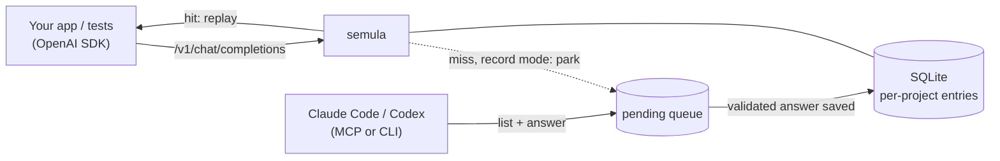

# semula

**A fake LLM server that learns from your coding agent.** Point your OpenAI-compatible app at it. The first time a prompt is new, your Claude Code or Codex subscription writes the answer. Every run after that replays it instantly, offline, for free.

> **Status: pre-alpha.** Record-then-replay works end to end for non-streaming chat completions. Streaming, tool-call validation, projects, MCP and the dashboard are still to come. Follow progress on the [slices](docs/SLICES.md).



## Why

Development and test runs call the same prompts over and over, and a paid API bills every one. Hand-written mocks break the moment a framework adds a timestamp or reorders a tool list. semula normalises that noise, matches tolerantly, and never serves a weak guess silently: near-misses go to a review queue.

## What it will do

- Speak the OpenAI Chat Completions API: text, streaming and tool calls.
- Record mode: an unknown prompt is parked, a coding agent answers it over MCP or CLI, semula validates and saves it.
- Replay mode: known prompts return the stored answer with no network. Target: p95 under 15 ms.
- Organise recordings by project; export them to files you can commit and diff.
- A human dashboard to watch calls, answer pending ones and review near-misses (after the core).

## Try it

From a clone (needs [uv](https://docs.astral.sh/uv/)). Not on PyPI yet.

```bash
git clone https://github.com/leejianrong/semula && cd semula
uv sync
SEMULA_MODE=record uv run semula serve        # terminal 1, listens on 127.0.0.1:8080
```

Point any OpenAI-compatible client at `http://127.0.0.1:8080/v1`. The first call for a new prompt is held. In a second terminal, answer it as your coding agent would:

```bash
uv run semula pending                          # id, status, project, last message
uv run semula answer <id> --text "hi from the agent"
```

The held call returns. Ask the same thing again, even with a different model name or a new timestamp in the prompt, and the stored answer comes back at once. Restart with `SEMULA_MODE=replay` and it works offline; unknown prompts return an error instead of a made-up answer.

Or run the container: `make docker` (Docker; picks the first free port from 8080).

## Documents

| | |
|---|---|
| [`PLAN.md`](docs/PLAN.md) | Problem, scope, requirements, architecture |
| [`SLICES.md`](docs/SLICES.md) | Build increments with acceptance checks |
| [`QUESTIONS.md`](docs/QUESTIONS.md) | Decision register |
| [`docs/adr/`](docs/adr/) | Architecture decisions |
| [`docs/INDAH-REQUESTS-PROMPT.md`](docs/INDAH-REQUESTS-PROMPT.md) | What the dashboard needs from [indah](https://github.com/leejianrong/indah) |

## Contributing

See [`CONTRIBUTING.md`](CONTRIBUTING.md). Agents: read [`AGENTS.md`](AGENTS.md).

## License

[Apache License 2.0](LICENSE).
