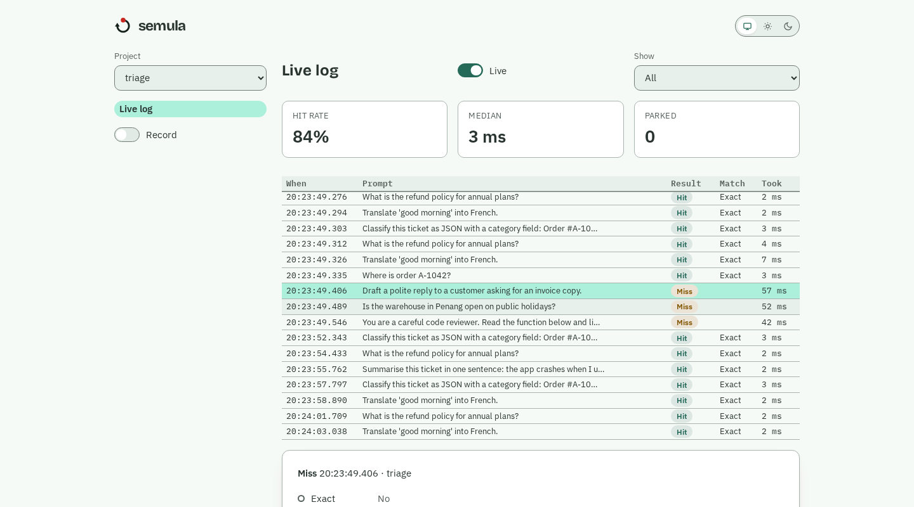

# Round 2 for indah: what an expressive semula dashboard still needs

Status: proposed. Written after building the live log on indah 0.3.0 (`src/semula/dashboard/`, run `make demo` to see it) and reading indah's `main` (0.4.0 in progress). Round 1 ([`INDAH-REQUESTS-PROMPT.md`](INDAH-REQUESTS-PROMPT.md)) asked for the dashboard's base; indah delivered it and, in IND-E28, fixed the first findings ([`INDAH-FINDINGS.md`](INDAH-FINDINGS.md)): `py.typed`, exact page title, `max_width`, absolute table time, extra theme tokens, `{{placeholder}}` highlighting, import time. Thank you. This round is about **expressiveness**: the design in [`design/`](design/README.md) is richer than the component set, and where indah cannot say it we have so far shrunk the design. The owner's direction is the opposite: keep the design and grow indah.

How to read it: every item has what we do today (the workaround, so you can see the cost), a proposal, and what done looks like. Sizes are ours, in the card. Priorities: **P0** blocks the design as drawn, **P1** is polish users will notice, **P2** is signature touches. Items already carded on IND (IND-139 content type and shared session, IND-118 to IND-122 hosted hardening) are not repeated. Nothing here changes the wire protocol's meaning; most is additive props and components.

The principle for the whole list: **primitives that compose, plus one escape hatch** (R2-6), so a good visual idea does not wait for a release, and the good ones come back upstream as components.

## P0: the design cannot be drawn without these

### R2-1 `Chips` and `Segmented`
Today: the log's filter is a `Select` and the mode a `Switch`, because `Radio` stacks vertically, `Tabs` wraps children and `Button(variant=)` cannot change with state. The design has filter chips (All, Hits, Misses, Recorded, optionally with counts) and a segmented Replay | Record control that doubles as the "mode lamp".
Proposal: `Chips(value: Signal[str] | Signal[list], options, multi=False)` and `Segmented(value, options)`; an option may be `(value, label, count)`; arrow keys move, Space/Enter select, `role=radiogroup`/`toolbar` with proper aria; tones for the selected state (`Segmented(tones={"record": "err"})`) so Record can be the red.

### R2-2 Reactive options
Today: `Select(options=[...])` is read once, so a project created later does not appear in the switcher until the tab reloads.
Proposal: `options` accepts a `Signal`, `Computed` or callable on `Select`, `Radio`, `MultiSelect`, `Chips` and `Segmented`; the selection survives if its value is still present.

### R2-3 Layout primitives
Today: a header row of title, Live switch and filter spreads across the full width with no way to say "title left, controls right", a `Card` always pads and outlines, and there is no divider or spacer.
Proposal: `Row(justify="start|center|end|between", align=, gap=)`, `Column(gap=)`, `Spacer()`, `Divider()`, `Card(variant="outlined|flat|tonal", padding="none|sm|md")`.

### R2-4 `AppShell`
Today: `Sidebar(children=[nav, pages])` under indah's own header, so the project switcher, nav and mode sit in the same flow as the page. The design is a pinned 256 px rail (logo, project switcher, nav with counts, the mode control at the bottom) and a main area with its own top bar.
Proposal: `AppShell(rail=, top=, main=, rail_width="16rem")`: the rail stays put while main scrolls; below a breakpoint the rail becomes a drawer opened from a menu button; `top` is a slot for the page title and actions; honours `max_width=` for `main`.

### R2-5 Rich table cells, and truncation
Today: cells are text, mono, badge, time or number. The design's Match column draws the **tier rail** (five dots, filled for the one that answered) in every row, and the live log needs more than one value per cell. Separately, a plain text cell cannot truncate: a long prompt pushed the other columns off the page, so we cut the string in Python (`rows.short`, 64 characters) and lose the rest.
Proposal: (a) `Col(kind="cell", render=<render spec>)` using the same spec language as `List` items, bound to the row's fields (`bind`/`text`), so a cell can hold a few spans, an inline SVG-free glyph made of styled elements, a badge and a tooltip; (b) `Col(truncate=True)` and `Col(max_width="40ch")` giving an ellipsis with the full text in the tooltip, and `wrap=True` as the alternative.

### R2-6 A component bridge for web components (ADR, then build)
Today: `register_component` takes a render spec with a fixed tag list. The tier rail, the per-minute activity strip and the "shaded text is ignored" request view are all draw-it-yourself, and each would otherwise wait for an indah release.
Proposal: let an app register a custom element: `register_component("tier-rail", module="static/tier-rail.js")`, an ES module the app serves (under a CSP nonce, never inline), with props passed as properties, signal changes delivered as property sets, and `dispatchEvent(new CustomEvent("indah", {detail}))` mapped to a Python handler. An ADR first: security (what a module can do, same-origin only), how themes reach it (CSS variables already do), lifecycle, SSR-free fallback text.

## P1: polish users will notice

### R2-7 `NavItem` with a count
Today: `Link(ctx, label)` takes a plain string, so the design's red count on Pending and Review cannot sit inside the item; a `Badge` beside it cannot hide at zero.
Proposal: `NavItem(ctx, label, to=, badge=Source, icon=, match=)`; the badge disappears when empty or zero; the red is the `err` role.

### R2-8 Reactive document title and favicon
Today: the tab title is static. The design's whole idea is "what needs me?": a parked call should show in the tab, "(2) semula", and the favicon should carry the red record dot.
Proposal: `ctx.title: Signal[str]` and `ctx.favicon: Signal[str]` from a small set the app registers (`create_app(favicons={"alert": ...})`).

### R2-9 Async session factory and `Skeleton`
Today: the factory is synchronous, so stats and counts load a moment later and arrive as patches (a dash, then the number).
Proposal: the factory may be `async def` (awaited before the first snapshot, with a time limit), and a `Skeleton(lines=, height=)` placeholder for what is still loading.

### R2-10 `ctx.every` and `ctx.spawn`
Today: each tab runs a refresh loop we wrote by hand (`dashboard/state.py: every`): an `asyncio` task cancelled from `ctx.on_close`.
Proposal: `ctx.every(seconds, fn)` and `ctx.spawn(coro)`, both cancelled when the session ends, with exceptions logged once.

### R2-11 `Text(variant=)`
Today: a plain `Text` renders heading-sized; body copy needs `markdown=True`.
Proposal: `Text(source, variant="body|title|label|caption|mono")`, `body` by default.

### R2-12 Logo per colour scheme
Today: one logo file, so the dark mark vanishes on the dark page. We ship an SVG with its own `prefers-color-scheme` rule, which follows the OS, not indah's toggle.
Proposal: `logo=(light_path, dark_path)`, or accept an SVG that uses `currentColor`.

### R2-13 `Marked`: text with highlighted spans
Today: the design shades the part of a request that is ignored when matching (timestamps, ids, paths). We show plain text.
Proposal: `Marked(text, marks=[(start, end, "ignored"|"changed"|"match")])`, selectable and copyable, tones from the theme; the same component serves the review screen.

### R2-14 `Empty` and `Code(copy=True)`
Today: an empty log is an empty table. The best empty state tells you the one command that fills it.
Proposal: `Empty(title=, body=, action=, children=)` and `Code(text, language=, copy=True)` with a copy button and a "Copied" toast.

### R2-15 `InfoTip`
Today: `tooltip=` works on focusable elements (and opens on keyboard focus, which the design needs), but there is no ⓘ trigger, so supplementary facts (the design's text rule: under 80 characters, behind an ⓘ) have nowhere to hang.
Proposal: `InfoTip(text)`: a small focusable ⓘ button using the existing tip; tap toggles on touch.

### R2-16 Toast actions
Proposal: `ctx.toast("Approved", action=("Undo", fn), ttl=8)`. Today a toast cannot offer a way back, which a one-key approve needs.

### R2-17 `Menu`
Today: row actions are always-visible buttons, which does not scale past two. The design lists a menu.
Proposal: `Menu(trigger=, items=[MenuItem(label, on_click, danger=, shortcut=)])`, keyboard navigable, with `confirm=` like `Button`.

## P2: signature touches

### R2-18 `Sparkline` / `BarStrip`
The activity strip (calls per minute, hits and misses stacked) is a small chart that must not look like a chart widget. Proposal: `BarStrip(series, height="2.5rem", tones=)` with a tooltip per bar.

### R2-19 `Steps`
The tier rail generalised: `Steps(items=[{"label", "state": "done|current|skipped|off|pending", "detail"}], orientation="vertical|horizontal")`; the same thing serves any pipeline. (R2-6 could build it first; upstream it if it earns its place.)

### R2-20 Table keyboard navigation
`j`/`k` and arrows move the selected row, Enter opens it (`Table(on_open=)`), Home/End jump, with a visible focus ring, so the log and the queues can be run from the keyboard.

### R2-21 `CommandPalette`
`CommandPalette(commands, shortcut="mod+k")`: jump to a project or screen, run an action; the dashboard sits beside a terminal and should be driven like one.

## What we will do meanwhile

Build the Pending, Entries, Entry editor, Review and Playground screens on what exists, behind thin presentation modules (`dashboard/pages/*`), and drop each workaround as its replacement ships. Behaviour and tests do not depend on the components: `tests/support/ui.py` drives a tab over its event stream. After the Entries and editor screens we score indah against the hosted screens (SEM-55) with the state of this list in hand.
