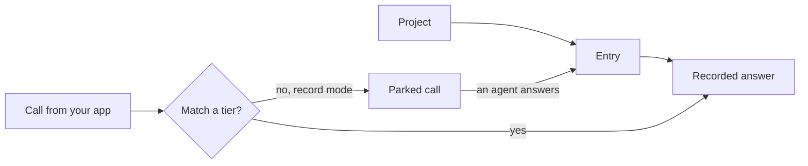

# Concepts

Eight words you will meet in the tutorial. Read this once, or come back when a term is unfamiliar.

**Project**
:   A namespace for recordings, usually one per app. Each project has its own entries, aliases and mode. See [Give each app its own project](tutorial/projects.md).

**Entry**
:   One stored prompt with its answer (or answers). Calls are matched against entries. You can edit, pin and template them: [Edit and protect a recording](tutorial/editing.md).

**Mode**
:   `record` answers unknown prompts by holding them for an agent. `replay` only serves what is stored and returns an error for anything else. Set it per project.

**Parked call**
:   A call semula has no answer for, in record mode. "Parked" means the HTTP request is held open while it waits. The same call shows up as *pending* in lists and the dashboard. An agent or a person answers it, and the app's request then completes.

**Miss**
:   A call that matched nothing. In record mode it parks; in replay mode it returns an error ([Errors](reference/errors.md)).

**Tier**
:   One way of matching a call to an entry, tried cheapest first: exact, normalised, alias, words, meaning. A weak match is never served silently. It goes to review instead. See [Handle near misses](tutorial/near-misses.md).

**Alias**
:   A human-approved link saying "this prompt may be answered by that entry".

**Cassette**
:   A project exported to a directory of JSON files, so recordings can live in git and be imported in CI. See [Keep recordings in git](tutorial/cassettes.md).

## Which word for what

The docs use one word per idea.

| Idea | Word | Not |
|---|---|---|
| A call semula has no answer for and is holding open | parked call | held, waiting, stuck |
| The list of parked calls | pending (`semula pending`) | queue, backlog |
| A stored prompt and its answer | entry | recording (the act of saving), cassette (the exported files) |
| What a person or agent supplies, or semula replays | answer | response, reply |

The reasoning behind these is in [Why calls park](explanation/why-calls-park.md) and [How matching works](explanation/how-matching-works.md).

Advanced terms (answerer hook, record-through, claim and lease) are explained where they are used, in [record through a real model](guide/record-through.md), [let a command answer each call](guide/answerer.md) and [manage a busy queue](guide/busy-queue.md).
