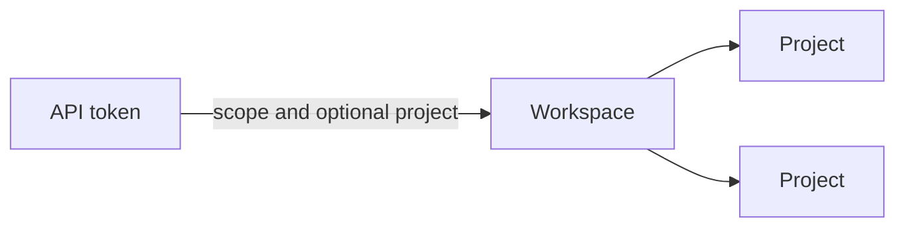

# How to host semula for a team

!!! note "Is this for you?"
    Most people never need hosted mode. If you work alone or share one laptop-sized server, the [local setup](service.md) is enough. Read on if several teams or apps must share one server with sign-in, roles and per-token limits. This page is for the person who runs that server.



Locally, semula trusts whoever can reach its port. To share one server between teams or projects, turn on hosted mode: every call then carries an **API token**, and the token decides which workspace, which project and what it may do. This page is the operator's view, and the list of [what is missing](#what-is-not-there-yet) is worth a read.

```bash
SEMULA_HOSTED=on SEMULA_DATABASE_URL=postgresql://... semula serve
```

In hosted mode the dashboard is off until a sign-in provider is set up (then it is behind that sign-in; see [the dashboard](#the-dashboard)), and `X-Semula-Actor` means nothing. `/health` stays open for load balancers.

## Workspaces and tokens

A **workspace** is a tenant: its projects, entries, review queue and log are invisible to every other workspace. The operator creates workspaces and mints the first tokens on the server, with `semula admin`, which works on the database directly:

```bash
semula admin workspace-create acme --name "Acme"
semula admin token-create --workspace acme --name ci-replay --scope replay
```

```text
created token 01M5HYWQZQMM2EA9YRS2WEHM07 (replay, ci-replay)
smla_live_…
This is the only time the token is shown.
```

Only a hash of the token is stored, so a lost token cannot be recovered, only replaced. Every token starts with `smla_live_`, which secret scanners can find if one leaks, and semula redacts that pattern from any prompt it stores.

## People signing in

People sign in with a provider you set up, and semula keeps no passwords. Register an application with the provider, with the redirect URI `https://<your host>/auth/callback/<name>` exactly (a different one is refused), and give semula its client id and secret:

Install the `hosted` extra (`pip install 'semula[hosted]'`), or use the hosted image, `ghcr.io/leejianrong/semula:<version>-hosted`, which has it and the Postgres driver (releases after 0.2.0; to build it yourself, `--build-arg UV_EXTRAS="--extra hosted --extra postgres"`), then:

```bash
SEMULA_PUBLIC_URL=https://semula.example.com
SEMULA_SECRET=$(openssl rand -hex 32)
SEMULA_AUTH_PROVIDERS=google,github
SEMULA_AUTH_GOOGLE_CLIENT_ID=...   SEMULA_AUTH_GOOGLE_CLIENT_SECRET=...
SEMULA_AUTH_GITHUB_CLIENT_ID=...   SEMULA_AUTH_GITHUB_CLIENT_SECRET=...
```

`/auth/login` lists the providers. Sign-in is the authorization-code flow with PKCE. semula checks `state`, the `nonce`, the issuer the response came from, the audience, the signature and the expiry of the ID token, and accepts only a **verified** email address. A person is the provider's `(issuer, subject)`, never an email: the same address at two providers is two people, and linking a second provider is something a signed-in person does. Google is OpenID Connect. GitHub does not issue ID tokens to apps, so semula reads the signed-in person's verified primary email from GitHub's API instead; any other OpenID Connect issuer works by naming it with `SEMULA_AUTH_<NAME>_ISSUER`.

A sign-in is a server-side row and an opaque cookie (`HttpOnly`, `SameSite=Lax`, and `Secure` with the `__Host-` prefix on https). It ends after 12 idle hours or 7 days, whichever is first, a new one is made at each sign-in (the old one ends), and signing out needs the session's CSRF token. Behind plain `http://` the cookie is not `Secure` and has no prefix; that is for trying it out only.

!!! note "Checked against a stand-in"
    The sign-in flow is tested end to end against a provider written for the tests. It speaks the real protocol and is made to misbehave in ten ways (a wrong state, nonce, audience, issuer or signature, an expired or unsigned token, a reused code, an unverified email). The flow has not been run against Google's or GitHub's own servers, so check your first real sign-in, and the redirect URI in particular.

## Signing up with an invite code

An invitation (below) puts someone in a workspace that already exists. To let someone start with a workspace of their own, make an **invite code**:

```bash
semula admin signup-code-create --uses 5 --days 14 --note "beta list"
```

```
code smla_code_…
works for 5 people until 2026-11-14T09:30:00.000Z
They sign in at https://semula.example.com/auth/signup and enter it. It is shown only now.
```

The person signs in with a provider, opens `/auth/signup`, enters the code and lands in a new workspace where they are the admin, with the same [limits](#limits) as any other. Each person can do this once, and a code works for the number of people you gave it. A code that is unknown, expired, revoked or used up gets the same answer, so it cannot be used to find out which codes exist. Only a hash of a code is stored, like a token. `semula admin signup-code-list` shows how many are used, and `signup-code-revoke <id>` ends one. A person who signs in with no workspace is told where to enter a code.

## Signing in from the CLI

An agent can run a command but cannot click through a dashboard, and nobody should paste a token by hand. `semula login` signs the CLI in by asking a person to approve it in a browser:

```bash
semula login --url https://semula.example.com --project myapp
```

```
Open this link in a browser where you are signed in, and approve it:

  https://semula.example.com/auth/device?code=KQ7P-3WXD

The page should show the code KQ7P-3WXD. If it does not, deny it.
Waiting for your approval...
```

The person opens the link, signs in if they are not, checks that the code matches and the workspace, scope and project are what they expect, and presses Approve. The CLI then keeps a token for that workspace and every command talks to the server with no flags. `semula whoami` shows what the login is and `semula logout` revokes the token on the server and forgets it.

- The token is never more than the person may do: a viewer gets `replay`, an editor at most `record`, an admin up to `admin`. `--scope` asks for less than that (default `record`); `--project` binds it to one project.
- A code works for ten minutes and once. A denied, expired, unknown or already used code gets no token, and an unknown one gets the same answer as an expired one.
- The token expires after 90 days. Its secret is made when the CLI collects it and is never stored on the server, only its hash, like any token. It is never printed, only written to `credentials.json` (mode 0600).
- The person must belong to a workspace already; one who does not is told to join one first. The approval is for the workspace their session is working in.
- The CLI asks over `POST /auth/device/code` and polls `POST /auth/device/token`; both are covered by `SEMULA_AUTH_RATE`. At most 2000 sign-ins wait at once.

### Open signup

When you are ready to let anyone in, set `SEMULA_SIGNUP=open` and restart. No migration and no code change. The `/auth/signup` page then offers a workspace without a code (a person who has one can still enter it), and the dashboard's no-workspace page links to it.

- The person must be signed in, and the provider has vouched for their email, since a person who has not verified it cannot sign in at all.
- Each person does it once. One network (an IPv4 address, or an IPv6 /64) can make `SEMULA_SIGNUP_PER_ADDRESS` workspaces a day (default 3) and the whole server `SEMULA_SIGNUP_PER_DAY` (default 100). The counts are in the database, so a restart does not reset them; with several replicas they are shared, though two people signing up in the same instant can slip one past a limit on Postgres. Over a limit the person gets a page that says to try tomorrow (`429 signup_limit`).
- Behind a proxy, the address is the one [`SEMULA_TRUSTED_PROXIES`](#behind-a-reverse-proxy) lets semula believe; without it every person looks like the proxy and the per-address limit would count everyone together.
- A person who belongs to a [suspended](#suspending-a-workspace) workspace cannot make a new one, so suspension is not a way to start over.
- The sign-in routes keep their own rate limit (`SEMULA_AUTH_RATE`). Make workspaces with `semula admin signup-code-create` still, whenever you want someone in without opening the door.

## Members and roles

Signing in makes a person; **membership** lets them into a workspace, with one of three roles that apply to every project in it:

| | viewer | editor | admin |
|---|---|---|---|
| read entries, the log, pending calls, review candidates, usage | yes | yes | yes |
| answer, edit, pin, approve and reject, `test_match`, switch a project's mode | | yes | yes |
| force past a pin, delete entries, import and export, project settings | | | yes |
| create and delete projects, tokens, members and roles, invitations, the workspace | | | yes |

The last admin cannot leave or be demoted. A person who belongs to no workspace can do nothing.

Membership comes from an **invitation**: by email and role, good for seven days and for one person once. The operator invites the first admin from the command line, and admins invite everyone else:

```bash
semula admin invite --workspace acme --email boss@example.com --role admin
```

```text
invited boss@example.com as admin until 2026-10-30T12:00:00.000Z
https://semula.example.com/auth/invite/smla_inv_…
Send them the link; it works once, for them, after they sign in.
```

The link asks the person to sign in (with any provider), then to confirm, and it works only if the provider has **verified** the very email that was invited. An invitation is never a way to sign in: someone who cannot prove the address gets nothing. Whatever the reason, an expired, used, revoked or unknown invitation looks the same. `semula admin members --workspace acme` lists who belongs.

## Scopes

A token has one of three scopes, `replay`, `record` and `admin`, each including the ones before it, and may be limited to one project. A project-bound token reaches that project and nothing else: other projects, and the entries, pending calls and review candidates in them, answer `404` as if they did not exist. Listings (projects, pending, the log) hold only its own. It cannot create projects.

## MCP

A coding agent connects over MCP with the same token. Use a `record` token, bound to the project the agent works on:

```bash
claude mcp add --transport http semula https://semula.example.com/mcp/ \
  --header "Authorization: Bearer $SEMULA_TOKEN"
```

Each tool needs a scope. The agent's own work (`wait_for_pending`, `answer_pending`, `get_entry`, `upsert_entry`, `update_entry`, `test_match` and the reads) needs `record`. `delete_entry`, `approve_candidate`, `reject_candidate`, `set_mode`, `create_project`, `update_project_settings` and anything with `force` need `admin`, which a recording agent should not hold. MCP refuses any request that carries an `Origin` header, so a web page cannot drive it.

| Scope | May | May not |
|---|---|---|
| `replay` | `/v1`: get a recorded answer, list models. A miss is an error **even when the project is recording**: a replay token never parks a call. | anything under `/api` |
| `record` | everything in `replay`, plus the recording agent's work over `/api/v1`: list and answer pending calls, read, create and edit entries, read the log, `test_match`, read the review queue | force past a pin, delete, approve or reject, change settings or mode, import or export |
| `admin` | everything in its project or workspace, including force, delete, approve and reject, settings, mode, import and export | manage tokens (people only) |

The ceiling on `record` is deliberate. A recorded prompt is untrusted text that the recording agent reads, so a prompt-injected agent must not be able to destroy a human's pinned fix or approve a near match into serving.

Two more rules follow from the credential:

- **The actor comes from the token.** Every write by a token is an agent's, whatever header it sends, so pins protect human edits.
- **Tokens cannot manage tokens.** Minting, rotating and revoking need the operator's CLI (or, once it exists, a signed-in admin).

Try it:

```bash
curl http://localhost:8080/v1/models
```

```json
{"error": {"message": "Missing or invalid API token. Send 'Authorization: Bearer smla_live_...'.", "type": "authentication_error", "param": null, "code": "invalid_api_key"}}
```

A replay token asking for something it has not got fails fast, in a recording project too:

```json
{"error":{"message":"No recorded answer matches this request, and a replay token never parks a call.","type":"semula_error","param":null,"code":"semula_no_match"}}
```

A scope that is too low names what is needed:

```json
{"error": {"message": "This token has scope 'record'; this call needs 'admin'.", "type": "authentication_error", "param": null, "code": "insufficient_scope"}}
```

## Rotating and revoking

```bash
semula admin token-rotate --workspace acme 01M5HYWQZQMM2EA9YRS2WEHM07 --grace 86400
semula admin token-revoke --workspace acme 01M5HYWQZQMM2EA9YRS2WEHM07
```

Rotating mints a successor with the same name, scope and project, and the old token keeps working for the grace period (a day by default), so you can swap deployed configuration without an outage. Revoking is immediate in the process that revokes. A verified token is trusted for 30 seconds without asking the database, so **another replica can honour a revoked token for up to 30 seconds**. `semula admin token-list --workspace acme` shows when each token was last used and from which network (a /24 for IPv4, a /48 for IPv6, not a full address).

Failed attempts are rate limited per client address (20 a minute), and a blocked address waits even with a good token.

## Behind a reverse proxy

Put the server behind a proxy that ends TLS (Caddy, nginx, a cloud load balancer). Then every connection comes from the proxy, so the limit on failed attempts would count all your users as one address: twenty bad guesses from anyone would lock everyone out. Name the proxy so semula reads the real address from `X-Forwarded-For`:

```bash
SEMULA_TRUSTED_PROXIES=172.18.0.0/16     # the network the proxy connects from
```

The header is believed only when the connection comes from one of these addresses, and is read from the right: each of your proxies adds the address it received the request from, so the first address that is not one of yours is the client. Anything the client wrote further left is ignored. Without the setting the header is ignored altogether, so a client cannot choose its own address. Use the narrowest range that covers the proxy; `*` is refused.

A complete example for one machine is in the repository under `deploy/droplet`: Caddy for TLS, semula, Postgres with the two roles set up, and a daily purge, as one compose project.

## Several replicas

Run as many replicas as you like against one Postgres. They share live events (the call log, the pending count) and wake a parked call on one replica when another replica answers it, over Postgres `LISTEN/NOTIFY`. Publishing never waits for the network, and a parked call and a `wait_for_pending` also look again every second, so a notification that gets lost costs a second, not a hang. Put sticky sessions in front of the dashboard when it has sign-in.

Migrate once before a rollout, not on every start:

```bash
semula admin migrate                 # as the table owner
SEMULA_MIGRATE=off semula serve      # each replica: refuses to start if the database is behind
```

Replicas that do start together with migrating on take turns (an advisory lock), so a rollout without the extra step is safe too. Tokens, tenants and rate limits are per process: a revoked token can be honoured by another replica for up to 30 seconds, and the per-token rate limit is per replica.

## Limits

A hosted workspace has limits so that one tenant cannot use up the server. Defaults, each changeable with `SEMULA_QUOTA_<NAME>` (see [Configuration](../reference/configuration.md)):

| Limit | Default | What happens |
|---|---|---|
| Projects | 20 | `403 quota_exceeded` when creating one more |
| Entries | 50,000 | `403 quota_exceeded` when recording, answering or importing one more |
| Stored bytes (requests and answers) | 250 MB | `403 quota_exceeded` |
| Parked calls | 50 per project, 200 per workspace | `429 too_many_parked` for a call that would park |
| Active tokens | 50 | `403 quota_exceeded` when minting |
| Request body | 1 MB | `413 request_too_large` |
| A project's `record_timeout` | 15 minutes | `422` when setting a longer one |
| Request rate per token | 20 a second, bursts of 100 | `429 rate_limited` with `Retry-After` |

Beyond the workspace limits, one address and one person are held back too: sign-in routes allow 30 requests a minute for an address (`SEMULA_AUTH_RATE`), and the dashboard allows 40 open tabs for an address and 10 for a person (`SEMULA_UI_STREAMS_PER_ADDRESS`, `SEMULA_UI_TABS_PER_PERSON`). Behind a proxy these see the real client only if you set [`SEMULA_TRUSTED_PROXIES`](#behind-a-reverse-proxy); without it every user shares the proxy's one address.

The error body names the limit: `{"quota": {"name": "entries", "limit": 50000, "used": 50000}}`. Counters are kept as writes happen, in the same transaction, so a replay hit never counts anything and stays fast; `semula usage` shows them, and `semula admin recount` rebuilds them if they ever drift. A local server has no limits.

## Suspending a workspace

A free public server will be abused sooner or later. Deleting a workspace is the heavy remedy; suspending is the light one:

```bash
semula admin workspace-suspend acme --reason "spam"
semula admin workspace-resume acme
```

A suspended workspace's tokens are refused at once, on every surface (`/v1`, `/api/v1` and `/mcp`), with `403 workspace_suspended` and a message that says why, and its people cannot work in it: the dashboard tells them it is suspended and where to write. Nothing is deleted, so resuming gives everything back. A refusal is not counted as a failed token guess. Only the operator suspends or resumes; a workspace's own admin cannot, and neither can a token. Both are in the [audit log](#the-audit-log) (`workspace.suspend` and `workspace.resume`, with the reason). Another replica that has a token cached notices within the cache time (30 seconds), like a revoked token. An invitation into a suspended workspace is not valid until it is resumed.

Set `SEMULA_ABUSE_CONTACT` to an email address. The sign-in page then says where to report abuse, and `/terms` (a short terms and acceptable-use page the server serves when hosted) names the same address. The terms are a plain template: read them and make sure they say what you mean before you open the server to others.

## Deleting a workspace

```bash
semula admin workspace-delete acme --confirm acme
```

The id has to be typed back. The workspace is marked deleted: its tokens stop working at once (on other replicas within 30 seconds) and its data stays, so the operator can still export it, for **30 days**. `semula admin workspace-restore acme` brings it back, tokens included. After the grace, `semula admin workspace-purge` (run it on a schedule) deletes everything of that workspace in dependency order: the call log, the search index, entries and all they own, projects, tokens and the workspace itself. The audit log keeps a `workspace.delete` and a `workspace.purge` row and nothing else. The `default` workspace cannot be deleted, and a token never can. Backups hold deleted data until they expire.

## The audit log

Every change that matters is written to an append-only log: who did it (the operator, a token or, later, a person), what, to which target, from which address, with which request id. It covers tokens (create, rotate, revoke), projects (create, rename, delete, settings, mode, import), deleting an entry, every forced write and forced delete, approving or rejecting a review candidate and creating a workspace.

```bash
semula audit --action project.delete
```

The log keeps ids, key names and counts, never a prompt, an answer or a secret: a settings change records *which* settings changed, not their values. A database trigger refuses every `UPDATE` and every `DELETE` of a row younger than a year, so nothing can rewrite history, and a row older than that is pruned. Reading it needs the operator (or a signed-in admin, later), not a token.

## Postgres and roles

Hosting wants Postgres. Every tenant table has a [row-level-security](../reference/configuration.md) policy on `workspace_id`, so a query that forgot its filter sees nothing of another workspace's. The role that owns the tables, and any superuser, bypasses it. Migrate as the owner, then run semula as a role that is neither.

## Moving from SQLite to Postgres

A server can start on a SQLite file and move to Postgres later with everything in it: people, sign-ins, tokens, invitations, invite and device codes, suspended workspaces, projects, entries and their history, the call log, the audit log and the quota counters. Per-project [export and import](../reference/cli.md) moves entries only; this moves the deployment.

```bash
semula admin copy-to --database-url postgresql://semula_owner:...@db:5432/semula
```

Cutover, in order:

1. **Make an empty Postgres database** and, if you use the droplet stack, its `semula` app role (see [Postgres and roles](#postgres-and-roles)). A database that has only been migrated counts as empty; one with anything in it is refused, and so is copying a database onto itself.
2. **Stop the server** that uses the SQLite file. A copy of a database that is being written is not a snapshot. Take a backup of the file first (copy it while stopped).
3. **Run the copy where the SQLite file is**, with `SEMULA_DATABASE_URL` (or `SEMULA_DATA_DIR`) pointing at it, as the role that owns the Postgres tables, the one that migrates, not the role the server runs as: row-level security applies to that role and would refuse the rows, so the command says so and stops. To keep the password out of the process list, put the target in `SEMULA_COPY_TO_URL` and leave `--database-url` off.
4. **Read the counts it prints.** It migrates the target, copies every table in one transaction with ids, token hashes and timestamps unchanged, then checks each table's row count against the source and the target. A mismatch, or any error, rolls the whole copy back and leaves the target as it was, so you can fix the cause and run it again.
5. **Point the server at Postgres**: set `SEMULA_DATABASE_URL` to the app role's address and start it. Existing tokens and sign-in cookies work unchanged, and so do people's workspaces and roles. The search index (a Postgres server scans instead of using SQLite's FTS5) and each workspace's quota counters are rebuilt by the copy.
6. **Keep the SQLite file** until you are sure. Nothing is written to it, and moving back means starting from it again: copying from Postgres to SQLite is not supported.

The list of tables is read from the schema, so a table added in a later release is copied too. Rows are not rewritten, so a prompt or answer that contains a NUL character (which Postgres cannot store) makes the copy fail loudly rather than lose it.

## The dashboard

With a sign-in provider configured, `/ui` is the same dashboard as locally, behind sign-in. A page load without a sign-in goes to `/auth/login`; the dashboard's own calls get a 401. It shows one workspace, the one the person is working in, and what it offers follows their role. A **viewer** can read the log, entries, review and pending. An **editor** also answers, edits, approves and turns recording on. Controls a role may not use are not sent to the browser at all. The role is read again on every action, so an admin who demotes or removes someone is obeyed at that person's next click. A person who belongs to no workspace sees only a page saying so. A person who belongs to several has a *Workspace* menu above the project switcher: picking one is remembered by their sign-in and ends the open tab. A reload opens the dashboard in the new workspace with the role they hold there. Picking one they do not belong to is refused.

An **admin** also gets a *Workspace* section in the sidebar:

- **Members.** Everyone in the workspace with their role, to change or remove (the last admin cannot be demoted or removed, and the screen says why), and the open invitations to revoke. *Invite someone* takes an email and a role and shows the link once, in a box with a Copy button: `https://<your host>/auth/invite/<token>`. Reloading the page, or opening another tab, never shows it again; make a new invitation instead.
- **Tokens.** Every API token with its scope, project, the start of its secret and when it was last used. *New token* takes a name, a scope and, optionally, one project; the secret is shown once, like an invitation link. *Rotate* makes a successor and lets the old token run for 24 hours; *Revoke* stops one now (immediately on the replica that serves the click, within 30 seconds on the others).
- **Audit.** The [audit log](#the-audit-log), newest first, 50 to a page, filterable by action.
- **Usage.** What the workspace holds against its [limits](#limits), and *Delete this workspace*, which needs the workspace id typed back and can be undone with *Restore* during the 30 days.

Every one of these calls the same service as the REST API and the CLI, so the rules do not differ by surface: an editor who crafts the request by hand gets `insufficient_role` from the service, not from the screen.

## What is not there yet

- **Reloading by itself after a switch.** The workspace switcher ends the tab and asks for a reload: because the dashboard framework cannot reload a page from the server.
