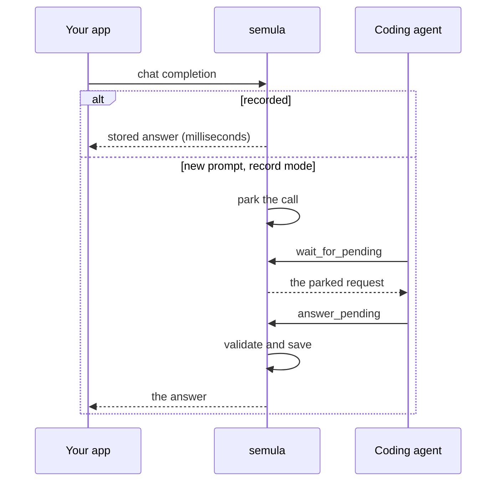

# semula

semula is a mock LLM server powered by your AI subscription. Instead of paying for an expensive LLM API, point your app at semula and let the Claude Code or Codex subscription you already have write the answers. semula serves an OpenAI-compatible endpoint, and your coding agent is the model behind it. The first time your app sends a prompt semula has never seen, it holds the call until your agent answers. As a bonus, every answer is recorded and replays instantly, offline and for free.

**For:** developers whose app or tests call an OpenAI-compatible API (OpenAI, Azure, Ollama, LiteLLM and the like) and who have a coding-agent subscription.
**You get:** an LLM API endpoint answered by your subscription, so no per-token bill. On top: the same answer every run, tests that work offline, and no weak guesses served silently.
**You need:** Docker and two terminals. The demo that follows takes about two minutes.

Start it in record mode (terminal 1):

```bash
docker run -d --name semula -p 127.0.0.1:8080:8080 \
  -e SEMULA_MODE=record -v semula-data:/data ghcr.io/leejianrong/semula
```

Send it a prompt, the way your app would. The call hangs, because nobody has answered yet. "Parked" means the request is held open until an answer arrives:

```bash
curl http://127.0.0.1:8080/v1/chat/completions \
  -H 'Content-Type: application/json' \
  -d '{"model": "gpt-4o", "messages": [{"role": "user", "content": "Name a fruit."}]}'
```

In terminal 2, see what is waiting and answer it:

```bash
docker exec semula semula pending
docker exec semula semula answer <id> --text "Mango"
```

The first `curl` returns `Mango`. Run it again and the answer comes back in a few milliseconds, with no one in the loop. That is the whole idea.

To use it from your own app, point the OpenAI client's `base_url` at `http://127.0.0.1:8080/v1`. Any API key works locally.



## Why bother

A paid API bills for every call, and dev and test runs make many. Your AI subscription is a flat fee you already pay. semula lets your app use it as an LLM API.

Recording is the cherry on top. Each answer is saved, so later runs cost nothing and take milliseconds. Hand-written mocks break the moment a framework adds a timestamp or reorders a tool list. semula normalises that noise and matches tolerantly, and it never serves a weak guess in silence: near misses wait in a review queue for you. For example, if a prompt differs from a recorded one by one word, semula parks it for review rather than answering with the old recording.

## Where to go next

New words? [Concepts](concepts.md) defines them in one page.

<div class="grid cards" markdown>

- **[Tutorial](tutorial/first-recording.md)**: learn by doing. Nine short pages, each one idea, each one runnable.
- **[Record with a coding agent](tutorial/agent.md)**: connect Claude Code or Codex so nobody types answers by hand.
- **[Guide](guide/install.md)**: tasks. Install options, running it as a service, upgrades and backups.
- **[Reference](reference/cli.md)**: lookups. Every command, MCP tool, endpoint and setting.
- **[Agent playbook](agents/PLAYBOOK.md)**: paste this into your coding agent's context.

</div>

!!! note "Pre-1.0"
    semula is 0.x. A minor release can change behaviour, and the [changelog](https://github.com/leejianrong/semula/blob/main/CHANGELOG.md) lists each change. Recordings made with one release open in the next.
