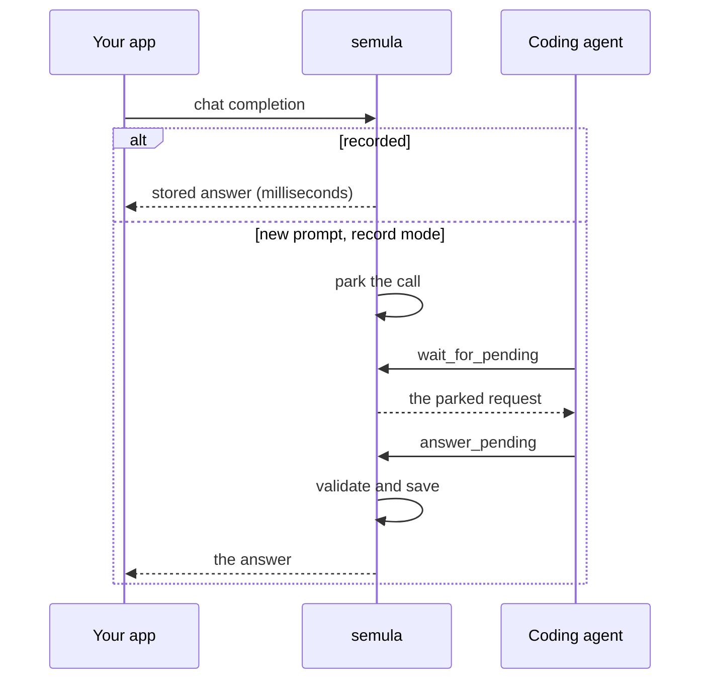

# semula

semula is a fake OpenAI-compatible server for development and tests. The first time your app sends a prompt it has never seen, semula holds the call and waits for your coding agent to write the answer. Every run after that replays the answer instantly, offline and for free.

Start it in record mode:

```bash
docker run -d --name semula -p 127.0.0.1:8080:8080 \
  -e SEMULA_MODE=record -v semula-data:/data ghcr.io/leejianrong/semula
```

Send it a prompt, the way your app would. The call hangs, because nobody has answered yet:

```bash
curl http://127.0.0.1:8080/v1/chat/completions \
  -H 'Content-Type: application/json' \
  -d '{"model": "gpt-4o", "messages": [{"role": "user", "content": "Name a fruit."}]}'
```

In a second terminal, see what is waiting and answer it:

```bash
docker exec semula semula pending
docker exec semula semula answer <id> --text "Mango"
```

The first `curl` returns `Mango`. Run it again and the answer comes back in a few milliseconds, with no one in the loop. That is the whole idea.



## Why bother

Test runs call the same prompts again and again, and a paid API bills for every one. Hand-written mocks break the moment a framework adds a timestamp or reorders a tool list. semula normalises that noise, matches tolerantly, and never serves a weak guess in silence: near misses wait in a review queue for you.

## Where to go next

<div class="grid cards" markdown>

- **[Tutorial](tutorial/first-recording.md)**: nine short pages, each one idea, each one runnable.
- **[Let an agent answer](tutorial/agent.md)**: connect Claude Code or Codex so nobody types answers by hand.
- **[Guide](guide/install.md)**: install options, running it as a service, upgrades and backups.
- **[Reference](reference/cli.md)**: every command, MCP tool, endpoint and setting.

</div>

!!! note "Pre-1.0"
    semula is 0.x. A minor release can change behaviour, and the [changelog](https://github.com/leejianrong/semula/blob/main/CHANGELOG.md) lists each change. Recordings made with one release open in the next.
