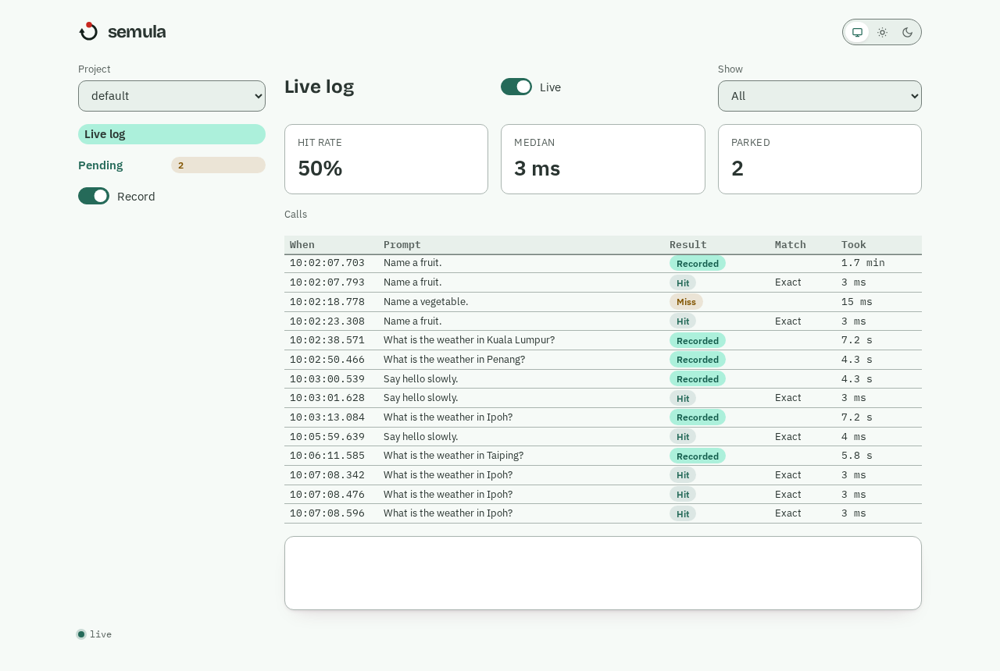
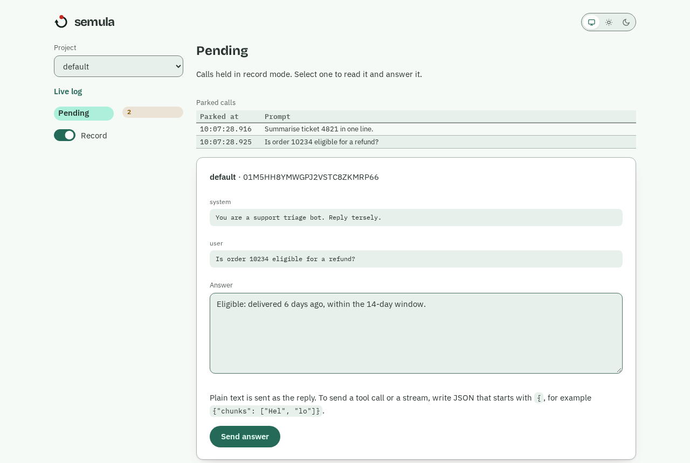

# Watch it in the dashboard

semula has a small web dashboard at `/ui`. Open `http://127.0.0.1:8080/ui/` and it lands on the live log of the project with the latest call.

## The live log

Every call appears as it happens, in every open tab. The three numbers above the table cover the last 30 minutes. Pick a row to see the request, the answer, and which tiers said yes or no. The **Record** switch in the sidebar sets the mode of the project you are looking at, and it is kept across restarts.

## The Pending screen

When a project is recording, parked calls are listed on the **Pending** screen, and the sidebar shows how many are waiting.

Select a call to read the whole request: the system prompt, the messages and any tools offered. Type the answer and press **Send answer**. The held call is released at once.

- Plain text is sent as the reply.
- Anything that starts with `{` or `[` is sent as JSON, so you can write a tool call or `{"chunks": [...]}`.
- If semula rejects the answer, the reason appears under the box and the call stays held. Fix it and send again.
- A call answered somewhere else, by an agent or the CLI, leaves the list on its own.

## Entries

The **Entries** screen lists what a project has recorded: the prompt, how often it has been hit, how many answers it holds, and flags for pinned, tool-call and aliased entries. Search by text, filter (pinned, never hit, has tool calls, has aliases) and sort (most hits, changed lately). New recordings appear as they are made.

Select a row to open the entry at its own address (`/ui/projects/<project>/entries/<id>`), so you can paste the link to a colleague. It shows the request, every answer and the history of changes.

### Fix a recording by hand

The same page edits the entry. Change the text in **Edit answer** and press **Save answer**. Plain text is the reply; start with `{` to write a tool call or `{"chunks": [...]}`. The answer is checked exactly as it is when an agent sends it, and a rejection appears under the box with nothing saved.

- **Pin** and **Unpin** protect the entry from agents. Your own edits go through a pin.
- **Add another answer** stores a second answer; **Pick** chooses `first`, `sequence` or `cycle`.
- If someone else changed the entry while you were typing, saving says so, keeps your text, and **Reload** shows their version. Your edit never overwrites theirs.
- **Delete entry** asks first.

## Good to know

The dashboard is built on the first visit to `/ui`, so the server starts as fast as ever. `SEMULA_UI=off` hides it.

!!! warning "No dashboard behind an API key"
    A browser cannot send an `Authorization` header on a page load. When `SEMULA_API_KEY` is set, the dashboard switches itself off. Use the CLI, MCP or REST there, or leave the key off and keep the port on loopback.

That is the tutorial. For installing differently, running semula as a standing service, and keeping your recordings safe, see the [guide](../guide/install.md).
